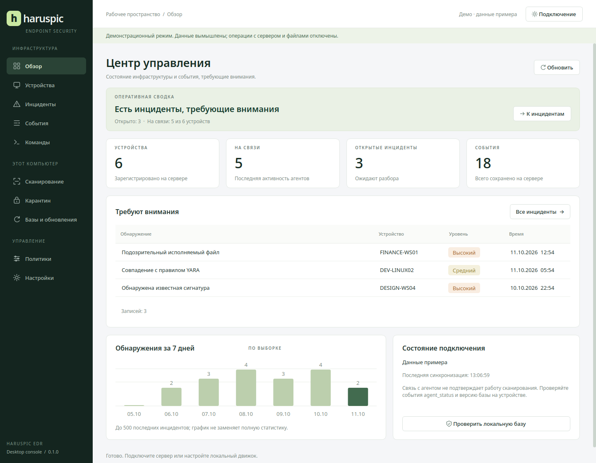

# haruspic_edr_gui

Нативная консоль Haruspic EDR на **PySide6 / Qt Widgets** для Linux и Windows.
Светлая рабочая область, тёмная навигация, спокойный зелёный акцент, таблицы с поиском,
карточки записей и отдельные разделы для инфраструктуры и локального компьютера.
Сеть и операции движка выполняются вне UI-потока.

## Запуск

Из корня проекта, Python 3.11+ и uv:

```sh
uv sync --project av_gui --locked
uv run --project av_gui --no-sync haruspic_edr_gui
```

Если PySide6 уже установлен: `python3 av_gui/main.py`.
Имя Python-пакета и точки входа — `haruspic_edr_gui`; рабочие файлы остаются в `av_gui`.

Для ознакомления с дизайном:

```sh
uv run --project av_gui --no-sync haruspic_edr_gui --demo
```

Демо явно помечено, использует вымышленные данные и блокирует операции с сервером,
движком и конфигурацией. Обычный запуск показывает честное состояние без подключения;
фиктивной статистики в рабочем режиме нет.



## Возможности

| Раздел | Действия |
| --- | --- |
| Обзор | Статистика сервера, открытые инциденты, доступность агентов, время синхронизации |
| Устройства | Поиск, сведения об агенте, переход к командам и истории |
| Инциденты | Открыть, взять в работу, закрыть; переход к исходному событию из загруженной выборки |
| События | Просмотр полей и payload, поиск, JSON-экспорт |
| Команды | `ping`, `collect_inventory`, `scan_path`; очередь и результаты последних 50 команд устройства |
| Сканирование | Проверка файла/каталога по хешам или YARA; режим `full` текущего движка; свои YARA-правила; явный карантин; отмена; сохранение текстового результата |
| Карантин | Список, восстановление в исходное место, окончательное удаление с подтверждением |
| Базы | Сведения об активной базе, срок действия, `check-feed`, установка подписанного обновления |
| Политики | Все текущие параметры серверной политики телеметрии, подтверждение перед применением ко всем агентам |
| Настройки | Подключение и импорт admin-credentials.json; пути CLI/конфигурации; наблюдение, исключения, реагирование, лимиты сканирования; журнал операций сеанса |

Таблицы сортируются по заголовку; поиск действует на загруженную выборку. `Ctrl+R`
обновляет текущий раздел, `Ctrl+,` открывает настройки. Экспорт JSON сохраняет всю
загруженную выборку текущей таблицы, а не только видимые после текстового поиска строки.

## Подключение

В «Настройки → Сервер» укажите URL и **admin token**, либо импортируйте
`admin-credentials.json`, созданный установщиком сервера. Для частного CA укажите PEM-файл.
Токен остаётся в памяти сеанса и не записывается в preferences, логи или экспорт.
После отключения таблицы очищаются; результаты старых запросов не применяются к новому
сеансу. Уже отправленный запрос может завершиться на сервере после отключения GUI.

Удалённый сервер требует HTTPS; HTTP разрешён только на loopback. TLS-проверка
всегда включена. Перенаправления отклоняются, чтобы токен не ушёл на другой адрес.
Ответ ограничен 8 MiB, один сетевой запрос — 12 сек. При разрыве связи последние
данные помечаются устаревшими. Автообновление активного раздела — раз в 30 секунд;
редактируемая политика автоматически не перезаписывается.

Используется существующий REST API `server/src/spire_server`, без изменений его
авторизации. gRPC-заготовка `av_gui/grpc_client.py` не используется.

## Локальный агент

В «Настройки → Локальный агент» выберите CLI `spire` / `spire.exe`, JSON-конфиг ядра
и TOML-конфиг агента. Автоматически ищутся пути установщика Spire и локальная
`target/release` / `target/debug`. Для существующего установщика сохраняются его
имена каталогов и переменных `SPIRE_*`; переименования GUI не меняют протокол агента.

CLI запускается с массивом аргументов, без shell. Применяются `SPIRE_CONFIG_PATH`,
`SPIRE_AGENT_CONFIG`, `SPIRE_STATE_DIR` и доверенный CA из настройки/установки агента.
GUI читает карантин и метаданные активной базы через SQLite в режиме `mode=ro`.
Подпись базы проверяет Rust CLI, а не чтение manifest в GUI.

Приложение работает с правами текущего пользователя. Если конфигурация или данные
агента доступны только root/SYSTEM/Administrators, локальные действия потребуют
соответствующего доступа. GUI не ослабляет права каталогов и не повышает привилегии.
Для обычного пользователя доступен административный REST-сеанс при наличии токена;
безопасный локальный privileged broker остаётся отдельной задачей перед массовой
клиентской поставкой.

Редактор наблюдения сохраняет неизвестные существующие поля и enrollment token,
не показывая секрет в форме. Перед записью проверяются пути, политика и актуальность
исходного файла; лимиты соответствуют текущим границам Rust-движка. Предыдущая
конфигурация сохраняется как `.gui-backup`. Изменённые настройки наблюдения и новая
база требуют перезапуска работающего агента; GUI не выдаёт сохранение за применение.

## Границы текущего движка и API

- Windows-инвентаризация процессов пока не реализована в агенте.
- `process-scan`, менеджер паролей и CLI-команда `config` — заглушки движка;
  GUI их не запускает. Настройка наблюдения реализована отдельным валидируемым редактором.
- `full` в текущем CLI выполняет YARA; GUI не называет его комбинированной проверкой.
- Доступность агента не означает, что все датчики работают. Отдельного полного
  protection-health API пока нет.
- Сервер возвращает максимум 500 последних инцидентов и 1 000 событий. График строится
  только по этой выборке. Получение старого события по ID, история без ограничения,
  удалённое управление карантином и изоляция хоста пока отсутствуют в API.
- Отмена сканирования останавливает процесс CLI; уже выполненный карантин не откатывается.
- Текстовый экспорт содержит сообщения CLI, а не список всех проверенных чистых файлов.

## Проверки

```sh
PYTHONPATH=av_gui QT_QPA_PLATFORM=offscreen python3 -B -m unittest discover -s av_gui/tests -v
PYTHONPATH=av_gui QT_QPA_PLATFORM=offscreen python3 -B av_gui/tests/integration.py
```

Для integration нужны собранные `spire` и `spire-feed` и Python сервера с зависимостями.
Переменные `SPIRE_TEST_BIN_DIR` и `SPIRE_SERVER_PYTHON` задают их расположение.
Тест создаёт временный localhost-сервер, подписывает безвредную фикстуру и выполняет
реальные GUI-действия: авторизация, статус инцидента, постановка команды, политика,
обновление, сканирование, карантин, восстановление. Службы ОС не устанавливаются.


## Самостоятельное приложение

Собирать на целевой ОС:

```sh
uv sync --project av_gui --locked --extra build
uv run --project av_gui --no-sync python av_gui/package.py
```

В `av_gui/dist` появится архив `haruspic_edr_gui-linux-x86_64.tar.gz` или
`haruspic_edr_gui-windows-x86_64.zip` и SHA-256. После распаковки запускайте
`haruspic_edr_gui` / `haruspic_edr_gui.exe` внутри одноимённого каталога.
Python и Qt включены в дистрибутив; CLI/сервер устанавливаются отдельно существующим
установщиком. Сборка onedir сохраняет отдельные библиотеки Qt и включает найденные
лицензионные тексты зависимостей. Windows Authenticode-подпись не настроена.

Независимый workflow `Haruspic desktop GUI` проверяет GUI на Linux/Windows и создаёт
нативные архивы вручную/по тегу; проверки Python GUI не зависят от состояния Rust-workspace.
Нативная Windows-сборка и запуск должны пройти CI/тестовую машину перед выпуском.
Linux-сборка наследует минимальную glibc машины сборки; CI использует Ubuntu 22.04.

Справочная документация: [Qt QThreadPool](https://doc.qt.io/qtforpython-6/PySide6/QtCore/QThreadPool.html),
[Qt for Python и PyInstaller](https://doc.qt.io/qtforpython-6/deployment/deployment-pyinstaller.html).
